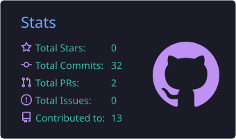
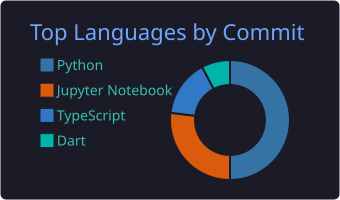
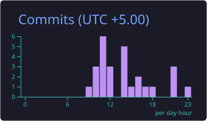

<div align="center">


<br/>


<br/><br/>


<a href="https://github.com/havindu99?tab=followers"></a>
<a href="https://github.com/havindu99?tab=repositories"></a>

</div>

<br/>

## 👋 About me

```python
class Havindu:
    role     = "Full-stack Developer & Data Engineer"
    based_in = "Sri Lanka"
    loves    = ["clean data", "useful dashboards", "shipping real products"]
    learning = ["system design", "cloud and DevOps", "AI agents"]
    open_to  = "internships, jobs and collaboration"
```

- 🛠 Building full-stack products with **React, Spring Boot and PostgreSQL**
- 📊 Writing **Python** for data processing, data quality and AI tooling
- 📱 Making mobile apps with **Flutter and Dart**
- 🤝 Looking for roles and projects where data and product meet

<br/>

## 🧰 Tech stack

<div align="center">

**Frontend and mobile**<br/>


**Backend and databases**<br/>


**Data, AI and tools**<br/>


</div>

<br/>

## 🚀 Featured projects

<table>
  <tr>
    <td colspan="2" valign="top">
      <h3><a href="https://github.com/ResQAI-Dev/ReliefNexus">🌏 ReliefNexus</a> <sub>team project · ResQAI-Dev</sub></h3>
      AI-powered disaster management and agentic AI platform. Connects incident reporting, risk assessment, resource planning, early warning and volunteer coordination in one system, with human oversight on AI decisions.<br/><br/>
      
      
      
      
      
      
      
      
    </td>
  </tr>
  <tr>
    <td width="50%" valign="top">
      <h3><a href="https://github.com/havindu99/AutoServe-Pro">🚗 AutoServe-Pro</a></h3>
      Enterprise vehicle service management platform.<br/><br/>
      
      
      
    </td>
    <td width="50%" valign="top">
      <h3><a href="https://github.com/havindu99/Leadpilot-ai">🤖 Leadpilot-ai</a></h3>
      AI-assisted lead handling tool.<br/><br/>
      
      
    </td>
  </tr>
  <tr>
    <td width="50%" valign="top">
      <h3><a href="https://github.com/havindu99/data-quality-monitoring-system">🔍 Data Quality Monitoring</a></h3>
      Catches bad data before it spreads.<br/><br/>
      
    </td>
    <td width="50%" valign="top">
      <h3><a href="https://github.com/havindu99/ExecutiveDashboardProject">📈 Executive Dashboard</a></h3>
      Management dashboard built from raw business data.<br/><br/>
      
    </td>
  </tr>
  <tr>
    <td width="50%" valign="top">
      <h3><a href="https://github.com/havindu99/DataProcessing">⚙️ DataProcessing</a></h3>
      Cleaning and transforming data for analysis.<br/><br/>
      
    </td>
    <td width="50%" valign="top">
      <h3><a href="https://github.com/havindu99/shopify_app">🛍 Shopify App</a></h3>
      Mobile shopping app.<br/><br/>
      
      
    </td>
  </tr>
</table>

<br/>

## 📊 GitHub activity

<div align="center">





<br/><br/>



</div>

<br/>

## 🐍 Contribution snake

<div align="center">
  <picture>
    <source media="(prefers-color-scheme: dark)" srcset="https://raw.githubusercontent.com/havindu99/havindu99/output/github-snake-dark.svg" />
    <source media="(prefers-color-scheme: light)" srcset="https://raw.githubusercontent.com/havindu99/havindu99/output/github-snake.svg" />
    
  </picture>
</div>

<br/>

## 🤝 Let's connect

<div align="center">

<a href="https://github.com/havindu99"></a>
<!-- Add your own links below, then remove the arrows:
<a href="https://www.linkedin.com/in/YOUR-NAME"></a>
<a href="mailto:YOUR-EMAIL"></a>
-->

</div>

<div align="center"><sub>Thanks for stopping by. Say hi, or open an issue on any repo.</sub></div>
